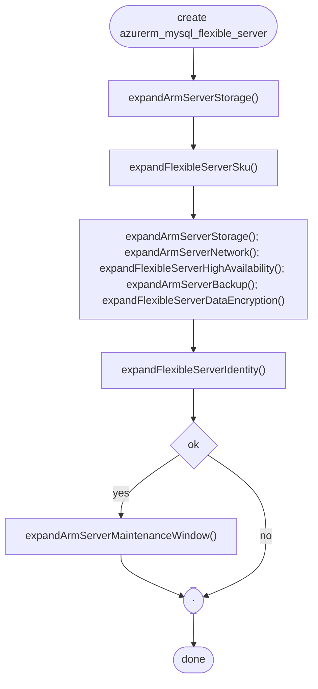
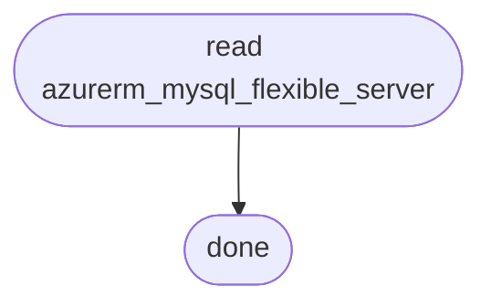
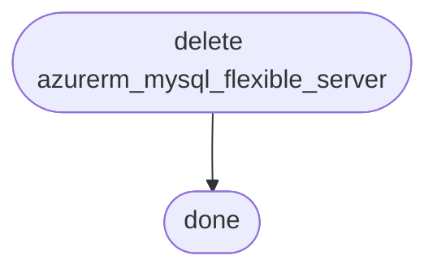

# azurerm_mysql_flexible_server — estratto dal codice del provider

Origine: `internal/services/mysql/mysql_flexible_server_resource.go` — provider eb79fcd (MPL-2.0), SDK v0.20261027.1151402 (MPL-2.0). facts derived from the source code; no source text is reproduced; both repositories are Mozilla Public License 2.0, copyright HashiCorp.

## Chiamate API

| Operazione | Metodo | Percorso | Versione API | Long-running |
|---|---|---|---|---|
| servers.ServersClient.Get | GET | `/subscriptions/{subscriptionId}/resourceGroups/{resourceGroupName}/providers/Microsoft.DBforMySQL/flexibleServers/{flexibleServerName}` | 2023-12-30 | False |
| servers.ServersClient.CreateCallbackThenPoll | PUT | `/subscriptions/{subscriptionId}/resourceGroups/{resourceGroupName}/providers/Microsoft.DBforMySQL/flexibleServers/{flexibleServerName}` | 2023-12-30 | True |
| servers.ServersClient.UpdateThenPoll | PATCH | `/subscriptions/{subscriptionId}/resourceGroups/{resourceGroupName}/providers/Microsoft.DBforMySQL/flexibleServers/{flexibleServerName}` | 2023-12-30 | True |
| serverfailover.ServerFailoverClient.ServersFailoverThenPoll | POST | `/subscriptions/{subscriptionId}/resourceGroups/{resourceGroupName}/providers/Microsoft.DBforMySQL/flexibleServers/{flexibleServerName}/failover` | 2023-12-30 | True |
| servers.ServersClient.DeleteThenPoll | DELETE | `/subscriptions/{subscriptionId}/resourceGroups/{resourceGroupName}/providers/Microsoft.DBforMySQL/flexibleServers/{flexibleServerName}` | 2023-12-30 | True |

## Flusso: create

## Flusso: read

## Flusso: update

```mermaid
flowchart TD
    n0(["update azurerm_mysql_flexible_server"])
    n1{"d.HasChange('storage') && d.Get('storage.0.au…"}
    n2["expandArmServerStorage()"]
    n3(["·"])
    n4{"requireFailover"}
    n5(["·"])
    n6{"d.HasChanges('backup_retention_days', 'geo_re…"}
    n7["expandArmServerBackup()"]
    n8(["·"])
    n9{"d.HasChange('customer_managed_key')"}
    n10["expandFlexibleServerDataEncryption()"]
    n11(["·"])
    n12{"d.HasChange('identity')"}
    n13["expandFlexibleServerIdentity()"]
    n14(["·"])
    n15{"d.HasChange('maintenance_window')"}
    n16["expandArmServerMaintenanceWindow()"]
    n17(["·"])
    n18{"d.HasChange('sku_name')"}
    n19["expandFlexibleServerSku()"]
    n20(["·"])
    n21{"d.HasChange('storage') && !d.Get('storage.0.a…"}
    n22["expandArmServerStorage()"]
    n23(["·"])
    n24(["done"])
    n0 --> n1
    n1 -->|yes| n2
    n2 --> n3
    n1 -->|no| n3
    n3 --> n4
    n4 --> n5
    n4 -->|no| n5
    n5 --> n6
    n6 -->|yes| n7
    n7 --> n8
    n6 -->|no| n8
    n8 --> n9
    n9 -->|yes| n10
    n10 --> n11
    n9 -->|no| n11
    n11 --> n12
    n12 -->|yes| n13
    n13 --> n14
    n12 -->|no| n14
    n14 --> n15
    n15 -->|yes| n16
    n16 --> n17
    n15 -->|no| n17
    n17 --> n18
    n18 -->|yes| n19
    n19 --> n20
    n18 -->|no| n20
    n20 --> n21
    n21 -->|yes| n22
    n22 --> n23
    n21 -->|no| n23
    n23 --> n24
```

## Flusso: delete

