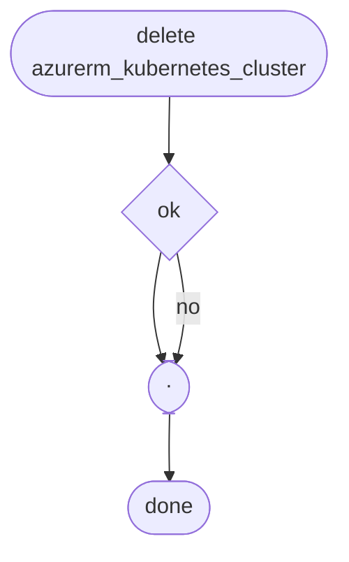

# `azurerm_object` output for `azurerm_kubernetes_cluster`

Example of what the `azurerm_object` MCP tool returns for one Terraform azurerm resource. Every section of the tool was queried
(`summary`, `arguments`, `api`, and `flow` for `create`, `read`, `update` and `delete`) and the results are collected here.

Calls used:

```
azurerm_object {"name":"azurerm_kubernetes_cluster"}
azurerm_object {"name":"azurerm_kubernetes_cluster","section":"arguments"}
azurerm_object {"name":"azurerm_kubernetes_cluster","section":"flow","operation":"create"}
azurerm_object {"name":"azurerm_kubernetes_cluster","section":"flow","operation":"read"}
azurerm_object {"name":"azurerm_kubernetes_cluster","section":"flow","operation":"update"}
azurerm_object {"name":"azurerm_kubernetes_cluster","section":"flow","operation":"delete"}
```

The tool returns facts derived from the provider code, never source text.

## Summary

| | |
|---|---|
| resource | `azurerm_kubernetes_cluster` |
| kind | `resource` |
| style | `untyped` |
| defined in | `internal/services/containers/resources/kubernetes_cluster/resource.go` |
| operations | create, read, update, delete |
| arguments | 70 |
| API calls | 14 |
| required | `default_node_pool`, `location`, `name`, `node_provisioning_profile`, `resource_group_name` |

### Provenance

| | repository | revision / tag | license |
|---|---|---|---|
| provider | `hashicorp/terraform-provider-azurerm` | `9906e7e` | MPL-2.0 |
| SDK | `hashicorp/go-azure-sdk` | `v0.20261027.1151402` | MPL-2.0 |

Facts derived from the source code; no source text is reproduced; both repositories are Mozilla Public License 2.0, copyright HashiCorp.

### Blocks (31)

`aci_connector_linux`, `api_server_access_profile`, `auto_scaler_profile`, `azure_active_directory_role_based_access_control`,
`bootstrap_profile`, `confidential_computing`, `default_node_pool`, `http_proxy_config`, `identity`, `ingress_application_gateway`,
`key_management_service`, `key_vault_secrets_provider`, `kube_admin_config`, `kube_config`, `kubelet_identity`, `linux_profile`,
`maintenance_window`, `maintenance_window_auto_upgrade`, `maintenance_window_node_os`, `microsoft_defender`, `monitor_metrics`,
`network_profile`, `node_provisioning_profile`, `oms_agent`, `service_mesh_profile`, `service_principal`, `storage_profile`,
`upgrade_override`, `web_app_routing`, `windows_profile`, `workload_autoscaler_profile`

### Arguments that force a new resource (12)

`disk_encryption_set_id`, `dns_prefix`, `dns_prefix_private_cluster`, `edge_zone`, `location`, `name`, `network_profile`,
`node_resource_group`, `private_cluster_enabled`, `private_dns_zone_id`, `resource_group_name`, `role_based_access_control_enabled`

## Arguments (`section: arguments`)

Legend: **R** required, **O** optional, **C** computed (O+C: optional, filled in by Azure when omitted), **FN** ForceNew, **S** sensitive.

### Scalar and top-level arguments

| argument | type | flags | default | validation / notes |
|---|---|---|---|---|
| `name` | string | R, FN | | not empty |
| `location` | string | R, FN | | `commonschema.Location()` |
| `resource_group_name` | string | R, FN | | `commonschema.ResourceGroupName()` |
| `automatic_upgrade_channel` | string | O | | enum (case-sensitive): `patch`, `rapid`, `stable`, `node-image` |
| `cost_analysis_enabled` | bool | O | | |
| `custom_ca_trust_certificates_base64` | list of string | O | | max 10 items; each element must be base64 |
| `disk_encryption_set_id` | string | O, FN | | generated resource ID |
| `dns_prefix` | string | O, FN | | `validate.KubernetesDNSPrefix`; exactly one of `dns_prefix`, `dns_prefix_private_cluster` |
| `dns_prefix_private_cluster` | string | O, FN | | exactly one of `dns_prefix`, `dns_prefix_private_cluster` |
| `edge_zone` | string | O, FN | | `commonschema.EdgeZoneOptionalForceNew()` |
| `fqdn` | string | C | | |
| `image_cleaner_enabled` | bool | O | | |
| `image_cleaner_interval_hours` | int | O | | range 24 to 2160 |
| `kube_admin_config_raw` | string | C, S | | |
| `kube_config_raw` | string | C, S | | |
| `kubernetes_version` | string | O, C | | not empty; diff suppressed by `helpers.SuppressKubernetesVersionDiff` |
| `local_account_disabled` | bool | O | | |
| `node_os_upgrade_channel` | string | O | `NodeImage` | enum (case-sensitive): `NodeImage`, `None`, `SecurityPatch`, `Unmanaged` |
| `node_resource_group` | string | O, C, FN | | |
| `current_kubernetes_version` | string | C | | |
| `node_resource_group_id` | string | C | | |
| `oidc_issuer_enabled` | bool | O | `true` | |
| `oidc_issuer_url` | string | C | | |
| `private_fqdn` | string | C | | |
| `portal_fqdn` | string | C | | |
| `private_cluster_enabled` | bool | O, FN | `false` | |
| `private_cluster_public_fqdn_enabled` | bool | O | `false` | |
| `private_dns_zone_id` | string | O, C, FN | | a private DNS zone ID, or one of `System`, `None` |
| `role_based_access_control_enabled` | bool | O, FN | `true` | |
| `run_command_enabled` | bool | O | `true` | |
| `sku_tier` | string | O | `Free` | enum (case-sensitive): `Free`, `Premium`, `Standard` |
| `support_plan` | string | O | `KubernetesOfficial` | enum (case-sensitive): `AKSLongTermSupport`, `KubernetesOfficial` |
| `tags` | map | O | | `commonschema.Tags()` |
| `ai_toolchain_operator_enabled` | bool | O | `false` | |
| `workload_identity_enabled` | bool | O | `false` | |
| `azure_policy_enabled` | bool | O | | |
| `http_application_routing_enabled` | bool | O | | |
| `http_application_routing_zone_name` | string | C | | |
| `open_service_mesh_enabled` | bool | O | | |

### Block arguments

All blocks are lists with `max_items: 1`, except `kube_admin_config` and `kube_config`, which are computed and carry no item limit.

| block | flags | child arguments |
|---|---|---|
| `default_node_pool` | R (via `helpers.SchemaDefaultNodePool()`) | `auto_scaling_enabled`, `capacity_reservation_group_id`, `fips_enabled`, `gpu_driver`, `gpu_instance`, `host_encryption_enabled`, `host_group_id`, `kubelet_config`, `kubelet_disk_type`, `linux_os_config`, `max_count`, `max_pods`, `min_count`, `name`, `node_count`, `node_labels`, `node_network_profile`, `node_public_ip_enabled`, `node_public_ip_prefix_id`, `only_critical_addons_enabled`, `orchestrator_version`, `os_disk_size_gb`, `os_disk_type`, `os_sku`, `pod_subnet_id`, `proximity_placement_group_id`, `scale_down_mode`, `snapshot_id`, `tags`, `temporary_name_for_rotation`, `type`, `ultra_ssd_enabled`, `upgrade_settings`, `vm_size`, `vnet_subnet_id`, `workload_runtime`, `zones` |
| `node_provisioning_profile` | R | `default_node_pools`, `mode` |
| `network_profile` | O, C, FN | `advanced_networking`, `dns_service_ip`, `ip_versions`, `load_balancer_profile`, `load_balancer_sku`, `nat_gateway_profile`, `network_data_plane`, `network_mode`, `network_plugin`, `network_plugin_mode`, `network_policy`, `outbound_type`, `pod_cidr`, `pod_cidrs`, `service_cidr`, `service_cidrs` |
| `identity` | O (`commonschema.SystemOrUserAssignedIdentityOptional()`) | `identity_ids`, `principal_id`, `tenant_id`, `type` |
| `service_principal` | O; exactly one of `identity`, `service_principal` | `client_id`, `client_secret` |
| `api_server_access_profile` | O | `authorized_ip_ranges`, `subnet_id`, `virtual_network_integration_enabled` |
| `auto_scaler_profile` | O, C | `balance_similar_node_groups`, `daemonset_eviction_for_empty_nodes_enabled`, `daemonset_eviction_for_occupied_nodes_enabled`, `empty_bulk_delete_max`, `expander`, `ignore_daemonsets_utilization_enabled`, `max_graceful_termination_sec`, `max_node_provisioning_time`, `max_unready_nodes`, `max_unready_percentage`, `new_pod_scale_up_delay`, `scale_down_delay_after_add`, `scale_down_delay_after_delete`, `scale_down_delay_after_failure`, `scale_down_unneeded`, `scale_down_unready`, `scale_down_utilization_threshold`, `scan_interval`, `skip_nodes_with_local_storage`, `skip_nodes_with_system_pods` |
| `azure_active_directory_role_based_access_control` | O | `admin_group_object_ids`, `azure_rbac_enabled`, `tenant_id` |
| `http_proxy_config` | O | `http_proxy`, `https_proxy`, `no_proxy`, `trusted_ca` |
| `web_app_routing` | O | `default_nginx_controller`, `dns_zone_ids`, `web_app_routing_identity` |
| `kube_admin_config` | C, S | `client_certificate`, `client_key`, `cluster_ca_certificate`, `host`, `password`, `username` |
| `kube_config` | C, S | `client_certificate`, `client_key`, `cluster_ca_certificate`, `host`, `password`, `username` |
| `kubelet_identity` | O, C | `client_id`, `object_id`, `user_assigned_identity_id` |
| `linux_profile` | O | `admin_username`, `ssh_key` |
| `bootstrap_profile` | O, C | `artifact_source`, `container_registry_id` |
| `maintenance_window` | O | `allowed`, `not_allowed` |
| `maintenance_window_auto_upgrade` | O | `day_of_month`, `day_of_week`, `duration`, `frequency`, `interval`, `not_allowed`, `start_date`, `start_time`, `utc_offset`, `week_index` |
| `maintenance_window_node_os` | O | `day_of_month`, `day_of_week`, `duration`, `frequency`, `interval`, `not_allowed`, `start_date`, `start_time`, `utc_offset`, `week_index` |
| `monitor_metrics` | O | `annotations_allowed`, `labels_allowed` |
| `key_management_service` | O | `key_vault_id`, `key_vault_key_id`, `key_vault_network_access` |
| `microsoft_defender` | O | `log_analytics_workspace_id` |
| `service_mesh_profile` | O | `certificate_authority`, `external_ingress_gateway_enabled`, `internal_ingress_gateway_enabled`, `mode`, `revisions` |
| `storage_profile` | O | `blob_driver_enabled`, `disk_driver_enabled`, `file_driver_enabled`, `snapshot_controller_enabled` |
| `upgrade_override` | O | `effective_until`, `force_upgrade_enabled` |
| `windows_profile` | O, C | `admin_password`, `admin_username`, `gmsa`, `license` |
| `workload_autoscaler_profile` | O | `keda_enabled`, `vertical_pod_autoscaler_enabled` |
| `aci_connector_linux` | O | `connector_identity`, `subnet_name` |
| `confidential_computing` | O | `sgx_quote_helper_enabled` |
| `oms_agent` | O | `log_analytics_workspace_id`, `msi_auth_for_monitoring_enabled`, `oms_agent_identity`, `retina_flow_logs_enabled` |
| `ingress_application_gateway` | O | `effective_gateway_id`, `gateway_id`, `gateway_name`, `ingress_application_gateway_identity`, `subnet_cidr`, `subnet_id` |
| `key_vault_secrets_provider` | O | `secret_identity`, `secret_rotation_enabled`, `secret_rotation_interval` |

The tool returns only the child names here. Pass `argument='block.child'` (for example `network_profile.network_plugin`) for the full detail of one argument.

## Azure REST calls (`section: api`)

All calls use API version `2026-07-01`. `<commonids.KubernetesClusterId>` stands for
`/subscriptions/{subscriptionId}/resourceGroups/{resourceGroupName}/providers/Microsoft.ContainerService/managedClusters/{managedClusterName}`.
Maintenance configurations live under `<commonids.KubernetesClusterId>/maintenanceConfigurations/{maintenanceConfigurationName}` and agent pools under
`<commonids.KubernetesClusterId>/agentPools/{agentPoolName}`.

| client | method | HTTP | path | long running | SDK package |
|---|---|---|---|---|---|
| `maintenanceconfigurations` | `Get` | GET | `<cluster>/maintenanceConfigurations/{name}` | no | `containerservice/2026-07-01/maintenanceconfigurations` |
| `maintenanceconfigurations` | `CreateOrUpdateCallbackThenPoll` | PUT | `<cluster>/maintenanceConfigurations/{name}` | yes | `containerservice/2026-07-01/maintenanceconfigurations` |
| `maintenanceconfigurations` | `Delete` | DELETE | `<cluster>/maintenanceConfigurations/{name}` | no | `containerservice/2026-07-01/maintenanceconfigurations` |
| `managedclusters` | `Get` | GET | `<commonids.KubernetesClusterId>` | no | `containerservice/2026-07-01/managedclusters` |
| `managedclusters` | `ListClusterUserCredentials` | POST | `<commonids.KubernetesClusterId>/listClusterUserCredential` | no | `containerservice/2026-07-01/managedclusters` |
| `managedclusters` | `ListClusterAdminCredentials` | POST | `<commonids.KubernetesClusterId>/listClusterAdminCredential` | no | `containerservice/2026-07-01/managedclusters` |
| `managedclusters` | `ResetServicePrincipalProfileThenPoll` | POST | `<commonids.KubernetesClusterId>/resetServicePrincipalProfile` | yes | `containerservice/2026-07-01/managedclusters` |
| `managedclusters` | `ResetAADProfileThenPoll` | POST | `<commonids.KubernetesClusterId>/resetAADProfile` | yes | `containerservice/2026-07-01/managedclusters` |
| `managedclusters` | `CreateOrUpdateThenPoll` | PUT | `<commonids.KubernetesClusterId>` | yes | `containerservice/2026-07-01/managedclusters` |
| `managedclusters` | `UpdateTagsThenPoll` | PATCH | `<commonids.KubernetesClusterId>` | yes | `containerservice/2026-07-01/managedclusters` |
| `agentpools` | `Get` | GET | `<cluster>/agentPools/{name}` | no | `containerservice/2026-07-01/agentpools` |
| `agentpools` | `GetAvailableAgentPoolVersions` | GET | `<commonids.KubernetesClusterId>/availableAgentPoolVersions` | no | `containerservice/2026-07-01/agentpools` |
| `agentpools` | `DeleteThenPoll` | DELETE | `<cluster>/agentPools/{name}` | yes | `containerservice/2026-07-01/agentpools` |
| `agentpools` | `CreateOrUpdateThenPoll` | PUT | `<cluster>/agentPools/{name}` | yes | `containerservice/2026-07-01/agentpools` |

Note: the `API calls` list contains no `DELETE` on the managed cluster itself, so the delete flow below shows only the maintenance configuration delete.
The extractor reports what it found in the code it follows; do not read this list as the complete set of calls made at run time.

## Flows (`section: flow`)

Diamonds are conditions, stadium shapes are joins. Node labels are the helper function or condition found in the code; long conditions are cut by the tool with `…`.

### create

API calls used: `managedclusters.Get`, `managedclusters.ListClusterUserCredentials`, `managedclusters.ListClusterAdminCredentials`,
`maintenanceconfigurations.Get`, `maintenanceconfigurations.CreateOrUpdateCallbackThenPoll`.

```mermaid
flowchart TD
    n0(["create azurerm_kubernetes_cluster"])
    n1["expandKubernetesClusterLinuxProfile()"]
    n2["expandKubernetesAddOns()"]
    n3["expandKubernetesClusterNetworkProfile()"]
    n4["expandKubernetesClusterMetricsProfile()"]
    n5{"ok"}
    n6["expandKubernetesClusterAzureActiveDirectoryRoleBasedAccessControl()"]
    n7(["·"])
    n8["expandKubernetesClusterWindowsProfile()"]
    n9["expandKubernetesClusterWorkloadAutoscalerProfile()"]
    n10["expandKubernetesClusterNodeProvisioningProfile()"]
    n11["expandKubernetesClusterAPIAccessProfile()"]
    n12["expandKubernetesClusterAutoScalerProfile()"]
    n13["expandKubernetesClusterAzureMonitorProfile()"]
    n14["expandBootstrapProfile()"]
    n15["expandKubernetesClusterHttpProxyConfig()"]
    n16["expandKubernetesClusterOidcIssuerProfile()"]
    n17["expandStorageProfile()"]
    n18["expandKubernetesClusterUpgradeOverrideSetting()"]
    n19["expandKubernetesClusterMicrosoftDefender()"]
    n20["expandKubernetesClusterAzureKeyVaultKms()"]
    n21["expandEdgeZone()"]
    n22{"len(managedClusterIdentityRaw) > 0"}
    n23["expandKubernetesClusterManagedClusterIdentity()"]
    n24(["·"])
    n25{"len(kubernetesClusterIdentityRaw) > 0"}
    n26["expandKubernetesClusterIdentityProfile()"]
    n27(["·"])
    n28["expandKubernetesClusterIngressProfile()"]
    n29["expandKubernetesClusterServiceMeshProfile()"]
    n30{"ok"}
    n31["expandKubernetesClusterMaintenanceConfigurationDefault()"]
    n32(["·"])
    n33{"ok"}
    n34["expandKubernetesClusterMaintenanceConfigurationForCreate()"]
    n35(["·"])
    n36{"ok"}
    n37["expandKubernetesClusterMaintenanceConfigurationForCreate()"]
    n38(["·"])
    n39["GET managedclusters.Get; POST managedclusters.ListClusterUserCredentials; POST managedclusters.ListClusterAdminCredentials; GET maintenanceconfigurations.Get"]
    n40(["done"])
    n0 --> n1
    n1 --> n2
    n2 --> n3
    n3 --> n4
    n4 --> n5
    n5 -->|yes| n6
    n6 --> n7
    n5 -->|no| n7
    n7 --> n8
    n8 --> n9
    n9 --> n10
    n10 --> n11
    n11 --> n12
    n12 --> n13
    n13 --> n14
    n14 --> n15
    n15 --> n16
    n16 --> n17
    n17 --> n18
    n18 --> n19
    n19 --> n20
    n20 --> n21
    n21 --> n22
    n22 -->|yes| n23
    n23 --> n24
    n22 -->|no| n24
    n24 --> n25
    n25 -->|yes| n26
    n26 --> n27
    n25 -->|no| n27
    n27 --> n28
    n28 --> n29
    n29 --> n30
    n30 -->|yes| n31
    n31 --> n32
    n30 -->|no| n32
    n32 --> n33
    n33 -->|yes| n34
    n34 --> n35
    n33 -->|no| n35
    n35 --> n36
    n36 -->|yes| n37
    n37 --> n38
    n36 -->|no| n38
    n38 --> n39
    n39 --> n40
```



Helper functions: `expandBootstrapProfile`, `expandEdgeZone`, `expandKubernetesAddOns`, `expandKubernetesClusterAPIAccessProfile`,
`expandKubernetesClusterAutoScalerProfile`, `expandKubernetesClusterAzureActiveDirectoryRoleBasedAccessControl`,
`expandKubernetesClusterAzureKeyVaultKms`, `expandKubernetesClusterAzureMonitorProfile`, `expandKubernetesClusterHttpProxyConfig`,
`expandKubernetesClusterIdentityProfile`, `expandKubernetesClusterIngressProfile`, `expandKubernetesClusterLinuxProfile`,
`expandKubernetesClusterMaintenanceConfigurationDefault`, `expandKubernetesClusterMaintenanceConfigurationForCreate`,
`expandKubernetesClusterManagedClusterIdentity`, `expandKubernetesClusterMetricsProfile`, `expandKubernetesClusterMicrosoftDefender`,
`expandKubernetesClusterNetworkProfile`, `expandKubernetesClusterNodeProvisioningProfile`, `expandKubernetesClusterOidcIssuerProfile`,
`expandKubernetesClusterServiceMeshProfile`, `expandKubernetesClusterUpgradeOverrideSetting`, `expandKubernetesClusterWindowsProfile`,
`expandKubernetesClusterWorkloadAutoscalerProfile`, `expandStorageProfile`.

Unresolved: none.

### read

API calls used: `managedclusters.Get`, `managedclusters.ListClusterUserCredentials`, `managedclusters.ListClusterAdminCredentials`, `maintenanceconfigurations.Get`.

```mermaid
flowchart TD
    n0(["read azurerm_kubernetes_cluster"])
    n1{"model != nil"}
    n2["flattenEdgeZone()"]
    n3{"props != nil"}
    n4["flattenKubernetesClusterAPIAccessProfile()"]
    n5{"props.AddonProfiles != nil"}
    n6["flattenKubernetesAddOns()"]
    n7(["·"])
    n8["flattenKubernetesClusterAutoScalerProfile()"]
    n9["flattenKubernetesClusterAzureMonitorProfile()"]
    n10["flattenKubernetesClusterAzureServiceMeshProfile()"]
    n11{"identityProfile != nil"}
    n12["flattenKubernetesClusterIdentityProfile()"]
    n13(["·"])
    n14["flattenKubernetesClusterLinuxProfile()"]
    n15["flattenKubernetesClusterNetworkProfile()"]
    n16["flattenKubernetesClusterMetricsProfile()"]
    n17["flattenKubernetesClusterAzureActiveDirectoryRoleBasedAccessControl()"]
    n18["flattenAzureRmKubernetesClusterServicePrincipalProfile()"]
    n19["flattenKubernetesClusterWindowsProfile()"]
    n20["flattenKubernetesClusterUpgradeOverrideSetting()"]
    n21["flattenKubernetesClusterWorkloadAutoscalerProfile()"]
    n22["flattenKubernetesClusterNodeProvisioningProfile()"]
    n23["flattenKubernetesClusterHttpProxyConfig()"]
    n24["flattenKubernetesClusterMicrosoftDefender()"]
    n25["flattenKubernetesClusterIngressProfile()"]
    n26["flattenKubernetesClusterKeyVaultKms()"]
    n27{"props.AadProfile != nil && (props.DisableLoca…"}
    n28["flattenKubernetesClusterCredentials()"]
    n29(["·"])
    n30["flattenBootstrapProfile()"]
    n31(["·"])
    n32["flattenKubernetesClusterCredentials()"]
    n33{"configurationBody != nil && configurationBody…"}
    n34["flattenKubernetesClusterMaintenanceConfigurationDefault()"]
    n35(["·"])
    n36{"configurationBody != nil && configurationBody…"}
    n37["flattenKubernetesClusterMaintenanceConfiguration()"]
    n38(["·"])
    n39{"configurationBody != nil && configurationBody…"}
    n40["flattenKubernetesClusterMaintenanceConfiguration()"]
    n41(["·"])
    n42(["·"])
    n43(["done"])
    n0 --> n1
    n1 -->|yes| n2
    n2 --> n3
    n3 -->|yes| n4
    n4 --> n5
    n5 -->|yes| n6
    n6 --> n7
    n5 -->|no| n7
    n7 --> n8
    n8 --> n9
    n9 --> n10
    n10 --> n11
    n11 -->|yes| n12
    n12 --> n13
    n11 -->|no| n13
    n13 --> n14
    n14 --> n15
    n15 --> n16
    n16 --> n17
    n17 --> n18
    n18 --> n19
    n19 --> n20
    n20 --> n21
    n21 --> n22
    n22 --> n23
    n23 --> n24
    n24 --> n25
    n25 --> n26
    n26 --> n27
    n27 -->|yes| n28
    n28 --> n29
    n27 -->|no| n29
    n29 --> n30
    n30 --> n31
    n3 -->|no| n31
    n31 --> n32
    n32 --> n33
    n33 -->|yes| n34
    n34 --> n35
    n33 -->|no| n35
    n35 --> n36
    n36 -->|yes| n37
    n37 --> n38
    n36 -->|no| n38
    n38 --> n39
    n39 -->|yes| n40
    n40 --> n41
    n39 -->|no| n41
    n41 --> n42
    n1 -->|no| n42
    n42 --> n43
```



Helper functions: `flattenAzureRmKubernetesClusterServicePrincipalProfile`, `flattenBootstrapProfile`, `flattenEdgeZone`, `flattenKubernetesAddOns`,
`flattenKubernetesClusterAPIAccessProfile`, `flattenKubernetesClusterAutoScalerProfile`,
`flattenKubernetesClusterAzureActiveDirectoryRoleBasedAccessControl`, `flattenKubernetesClusterAzureMonitorProfile`,
`flattenKubernetesClusterAzureServiceMeshProfile`, `flattenKubernetesClusterCredentials`, `flattenKubernetesClusterHttpProxyConfig`,
`flattenKubernetesClusterIdentityProfile`, `flattenKubernetesClusterIngressProfile`, `flattenKubernetesClusterKeyVaultKms`,
`flattenKubernetesClusterLinuxProfile`, `flattenKubernetesClusterMaintenanceConfiguration`,
`flattenKubernetesClusterMaintenanceConfigurationDefault`, `flattenKubernetesClusterMetricsProfile`, `flattenKubernetesClusterMicrosoftDefender`,
`flattenKubernetesClusterNetworkProfile`, `flattenKubernetesClusterNodeProvisioningProfile`, `flattenKubernetesClusterUpgradeOverrideSetting`,
`flattenKubernetesClusterWindowsProfile`, `flattenKubernetesClusterWorkloadAutoscalerProfile`.

Unresolved: none.

### update

API calls used: `managedclusters.Get`, `managedclusters.ResetServicePrincipalProfileThenPoll`, `managedclusters.ResetAADProfileThenPoll`,
`managedclusters.CreateOrUpdateThenPoll`, `managedclusters.UpdateTagsThenPoll`, `agentpools.Get`, `agentpools.GetAvailableAgentPoolVersions`,
`agentpools.DeleteThenPoll`, `agentpools.CreateOrUpdateThenPoll`, `maintenanceconfigurations.CreateOrUpdate`, `maintenanceconfigurations.Delete`,
`maintenanceconfigurations.Get`, `managedclusters.ListClusterUserCredentials`, `managedclusters.ListClusterAdminCredentials`.

> **Truncated:** the tool cut this diagram at 60 nodes (`flow update azurerm_kubernetes_cluster truncated at 60 nodes`). It ends after `bootstrap_profile`;
> checks and API calls that come later in the code are not shown. Some `HasChanges(...)` conditions are also cut with `…`.

```mermaid
flowchart TD
    n0(["update azurerm_kubernetes_cluster"])
    n1{"d.HasChange('azure_active_directory_role_base…"}
    n2["expandKubernetesClusterAzureActiveDirectoryRoleBasedAccessControl()"]
    n3(["·"])
    n4{"d.HasChanges( 'aci_connector_linux', 'azure_p…"}
    n5["expandKubernetesAddOns()"]
    n6(["·"])
    n7{"d.HasChanges('run_command_enabled', 'private_…"}
    n8["expandKubernetesClusterAPIAccessProfile()"]
    n9(["·"])
    n10{"d.HasChange('auto_scaler_profile')"}
    n11["expandKubernetesClusterAutoScalerProfile()"]
    n12(["·"])
    n13{"d.HasChange('monitor_metrics')"}
    n14["expandKubernetesClusterAzureMonitorProfile()"]
    n15(["·"])
    n16{"d.HasChange('linux_profile')"}
    n17["expandKubernetesClusterLinuxProfile()"]
    n18(["·"])
    n19{"d.HasChange('cost_analysis_enabled')"}
    n20["expandKubernetesClusterMetricsProfile()"]
    n21(["·"])
    n22{"d.HasChange('network_profile')"}
    n23{"d.HasChange('network_profile.0.advanced_netwo…"}
    n24["expandKubernetesClusterAdvancedNetworking()"]
    n25(["·"])
    n26(["·"])
    n27{"d.HasChange('service_mesh_profile')"}
    n28["expandKubernetesClusterServiceMeshProfile()"]
    n29(["·"])
    n30{"d.HasChange('windows_profile')"}
    n31["expandKubernetesClusterWindowsProfile()"]
    n32(["·"])
    n33{"d.HasChange('identity')"}
    n34["expandKubernetesClusterManagedClusterIdentity()"]
    n35(["·"])
    n36{"d.HasChange('http_proxy_config')"}
    n37["expandKubernetesClusterHttpProxyConfig()"]
    n38(["·"])
    n39{"d.HasChange('oidc_issuer_enabled')"}
    n40["expandKubernetesClusterOidcIssuerProfile()"]
    n41(["·"])
    n42{"d.HasChanges('key_management_service')"}
    n43["expandKubernetesClusterAzureKeyVaultKms()"]
    n44(["·"])
    n45{"d.HasChanges('microsoft_defender')"}
    n46["expandKubernetesClusterMicrosoftDefender()"]
    n47(["·"])
    n48{"d.HasChanges('storage_profile')"}
    n49["expandStorageProfile()"]
    n50(["·"])
    n51{"d.HasChange('workload_autoscaler_profile')"}
    n52["expandKubernetesClusterWorkloadAutoscalerProfile()"]
    n53(["·"])
    n54{"d.HasChange('node_provisioning_profile')"}
    n55["expandKubernetesClusterNodeProvisioningProfile()"]
    n56(["·"])
    n57{"d.HasChange('bootstrap_profile')"}
    n58["expandBootstrapProfile()"]
    n59(["·"])
    n60(["done"])
    n0 --> n1
    n1 -->|yes| n2
    n2 --> n3
    n1 -->|no| n3
    n3 --> n4
    n4 -->|yes| n5
    n5 --> n6
    n4 -->|no| n6
    n6 --> n7
    n7 -->|yes| n8
    n8 --> n9
    n7 -->|no| n9
    n9 --> n10
    n10 -->|yes| n11
    n11 --> n12
    n10 -->|no| n12
    n12 --> n13
    n13 -->|yes| n14
    n14 --> n15
    n13 -->|no| n15
    n15 --> n16
    n16 -->|yes| n17
    n17 --> n18
    n16 -->|no| n18
    n18 --> n19
    n19 -->|yes| n20
    n20 --> n21
    n19 -->|no| n21
    n21 --> n22
    n22 -->|yes| n23
    n23 -->|yes| n24
    n24 --> n25
    n23 -->|no| n25
    n25 --> n26
    n22 -->|no| n26
    n26 --> n27
    n27 -->|yes| n28
    n28 --> n29
    n27 -->|no| n29
    n29 --> n30
    n30 -->|yes| n31
    n31 --> n32
    n30 -->|no| n32
    n32 --> n33
    n33 -->|yes| n34
    n34 --> n35
    n33 -->|no| n35
    n35 --> n36
    n36 -->|yes| n37
    n37 --> n38
    n36 -->|no| n38
    n38 --> n39
    n39 -->|yes| n40
    n40 --> n41
    n39 -->|no| n41
    n41 --> n42
    n42 -->|yes| n43
    n43 --> n44
    n42 -->|no| n44
    n44 --> n45
    n45 -->|yes| n46
    n46 --> n47
    n45 -->|no| n47
    n47 --> n48
    n48 -->|yes| n49
    n49 --> n50
    n48 -->|no| n50
    n50 --> n51
    n51 -->|yes| n52
    n52 --> n53
    n51 -->|no| n53
    n53 --> n54
    n54 -->|yes| n55
    n55 --> n56
    n54 -->|no| n56
    n56 --> n57
    n57 -->|yes| n58
    n58 --> n59
    n57 -->|no| n59
    n59 --> n60
```



Helper functions: `expandBootstrapProfile`, `expandKubernetesAddOns`, `expandKubernetesClusterAPIAccessProfile`,
`expandKubernetesClusterAdvancedNetworking`, `expandKubernetesClusterAutoScalerProfile`,
`expandKubernetesClusterAzureActiveDirectoryRoleBasedAccessControl`, `expandKubernetesClusterAzureKeyVaultKms`,
`expandKubernetesClusterAzureMonitorProfile`, `expandKubernetesClusterHttpProxyConfig`, `expandKubernetesClusterIngressProfile`,
`expandKubernetesClusterLinuxProfile`, `expandKubernetesClusterMaintenanceConfigurationDefault`,
`expandKubernetesClusterMaintenanceConfigurationForUpdate`, `expandKubernetesClusterManagedClusterIdentity`,
`expandKubernetesClusterMetricsProfile`, `expandKubernetesClusterMicrosoftDefender`, `expandKubernetesClusterNodeProvisioningProfile`,
`expandKubernetesClusterOidcIssuerProfile`, `expandKubernetesClusterServiceMeshProfile`, `expandKubernetesClusterUpgradeOverrideSetting`,
`expandKubernetesClusterWindowsProfile`, `expandKubernetesClusterWorkloadAutoscalerProfile`, `expandStorageProfile`.

Unresolved: `flow update azurerm_kubernetes_cluster truncated at 60 nodes`.

### delete

API calls used: `maintenanceconfigurations.Delete`.



Helper functions: none.

Unresolved: none.
