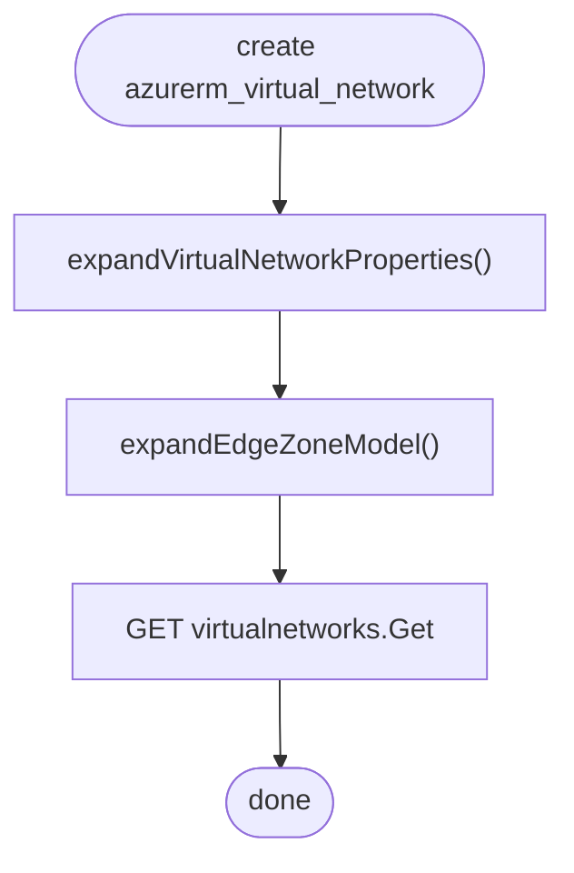
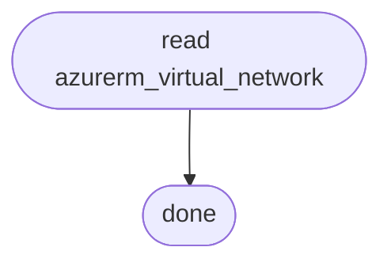
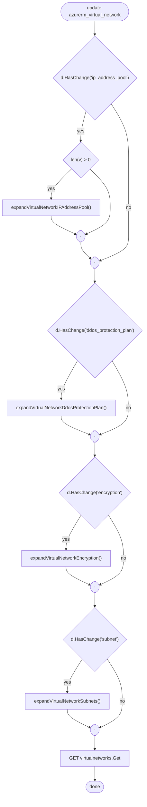
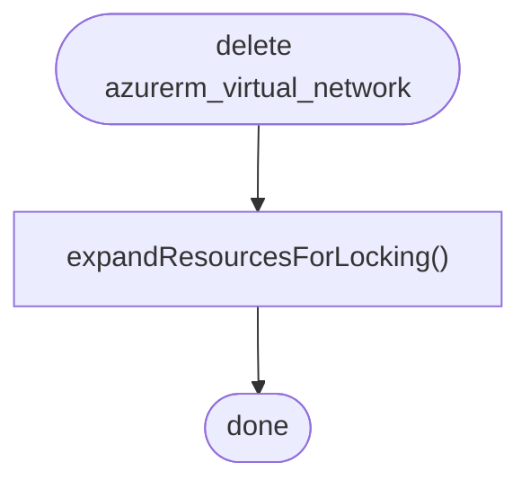

# `azurerm_object` output for `azurerm_virtual_network`

Example of what the `azurerm_object` MCP tool returns for one Terraform azurerm resource. Every section of the tool was queried
(`summary`, `arguments`, and `flow` for `create`, `read`, `update` and `delete`) and the results are collected here.
A second, larger example is [azurerm_kubernetes_cluster](azurerm_object-of-azurerm_kubernetes_cluster.md).

Calls used:

```
azurerm_object {"name":"azurerm_virtual_network"}
azurerm_object {"name":"azurerm_virtual_network","section":"arguments"}
azurerm_object {"name":"azurerm_virtual_network","section":"flow","operation":"create"}
azurerm_object {"name":"azurerm_virtual_network","section":"flow","operation":"read"}
azurerm_object {"name":"azurerm_virtual_network","section":"flow","operation":"update"}
azurerm_object {"name":"azurerm_virtual_network","section":"flow","operation":"delete"}
```

The tool returns facts derived from the provider code, never source text.

## Summary

| | |
|---|---|
| resource | `azurerm_virtual_network` |
| kind | `resource` |
| style | `untyped` |
| defined in | `internal/services/network/virtual_network_resource.go` |
| operations | create, read, update, delete |
| arguments | 15 |
| API calls | 3 |
| required | `location`, `name`, `resource_group_name` |

### Provenance

| | repository | revision / tag | license |
|---|---|---|---|
| provider | `hashicorp/terraform-provider-azurerm` | `9906e7e` | MPL-2.0 |
| SDK | `hashicorp/go-azure-sdk` | `v0.20261027.1151402` | MPL-2.0 |

Facts derived from the source code; no source text is reproduced; both repositories are Mozilla Public License 2.0, copyright HashiCorp.

### Blocks (4)

`ddos_protection_plan`, `encryption`, `ip_address_pool`, `subnet`

### Arguments that force a new resource (4)

`edge_zone`, `location`, `name`, `resource_group_name`

## Arguments (`section: arguments`)

Legend: **R** required, **O** optional, **C** computed (O+C: optional, filled in by Azure when omitted), **FN** ForceNew.

### Scalar and top-level arguments

| argument | type | flags | default | validation / notes |
|---|---|---|---|---|
| `name` | string | R, FN | | not empty |
| `resource_group_name` | string | R, FN | | `commonschema.ResourceGroupName()` |
| `location` | string | R, FN | | `commonschema.Location()` |
| `address_space` | set of string | O | | at least 1 item; each element not empty; exactly one of `address_space`, `ip_address_pool`; has a custom diff suppression (the tool shows only a truncated fragment, which is not reproduced here) |
| `bgp_community` | string | O | | `validate.VirtualNetworkBgpCommunity` |
| `dns_servers` | list of string | O, C | | each element not empty |
| `edge_zone` | string | O, FN | | `commonschema.EdgeZoneOptionalForceNew()` |
| `flow_timeout_in_minutes` | int | O | | range 4 to 30 |
| `guid` | string | C | | |
| `private_endpoint_vnet_policies` | string | O | `Disabled` | enum (case-sensitive): `Basic`, `Disabled` |
| `tags` | map | O | | `commonschema.Tags()` |

### Block arguments

| block | type | flags | child arguments |
|---|---|---|---|
| `ddos_protection_plan` | list, max 1 | O | `enable`, `id` |
| `encryption` | list, max 1 | O | `enforcement` |
| `ip_address_pool` | list, max 2 | O; exactly one of `address_space`, `ip_address_pool` | `allocated_ip_address_prefixes`, `id`, `number_of_ip_addresses` |
| `subnet` | set | O, C | `address_prefixes`, `default_outbound_access_enabled`, `delegation`, `id`, `name`, `private_endpoint_network_policies`, `private_link_service_network_policies_enabled`, `route_table_id`, `security_group`, `service_endpoint`, `service_endpoint_policy_ids` |

The tool returns only the child names here. Pass `argument='block.child'` (for example `subnet.address_prefixes`) for the full detail of one argument.

## Azure REST calls (`section: api`)

All calls use API version `2025-07-01`, SDK package `network/2025-07-01/virtualnetworks`, client `virtualnetworks.VirtualNetworksClient`.
`<commonids.VirtualNetworkId>` stands for
`/subscriptions/{subscriptionId}/resourceGroups/{resourceGroupName}/providers/Microsoft.Network/virtualNetworks/{virtualNetworkName}`.

| method | HTTP | path | long running |
|---|---|---|---|
| `Get` | GET | `<commonids.VirtualNetworkId>` | no |
| `CreateOrUpdateCallbackThenPoll` | PUT | `<commonids.VirtualNetworkId>` | yes |
| `CreateOrUpdateThenPoll` (update only) | PUT | `<commonids.VirtualNetworkId>` | yes |
| `DeleteThenPoll` | DELETE | `<commonids.VirtualNetworkId>` | yes |

The summary counts 3 calls because it merges the two create-or-update variants used by create and update.

## Flows (`section: flow`)

Diamonds are conditions, stadium shapes are joins. Node labels are the helper function or condition found in the code.

### create

API calls used: `virtualnetworks.Get`, `virtualnetworks.CreateOrUpdateCallbackThenPoll`.
The diagram shows the `GET` but no node for the `PUT`, although the PUT is in the call list.



Helper functions: `expandEdgeZoneModel`, `expandVirtualNetworkProperties`.

Unresolved: none.

### read

API calls used: `virtualnetworks.Get`. The extractor found no further steps, so the diagram has only start and end.



Helper functions: none.

Unresolved: none.

### update

API calls used: `virtualnetworks.Get`, `virtualnetworks.CreateOrUpdateThenPoll`.



Helper functions: `expandVirtualNetworkDdosProtectionPlan`, `expandVirtualNetworkEncryption`, `expandVirtualNetworkIPAddressPool`, `expandVirtualNetworkSubnets`.

Unresolved: none.

### delete

API calls used: `virtualnetworks.DeleteThenPoll`. The diagram shows the locking helper but no node for the `DELETE` call.



Helper functions: `expandResourcesForLocking`.

Unresolved: none.
